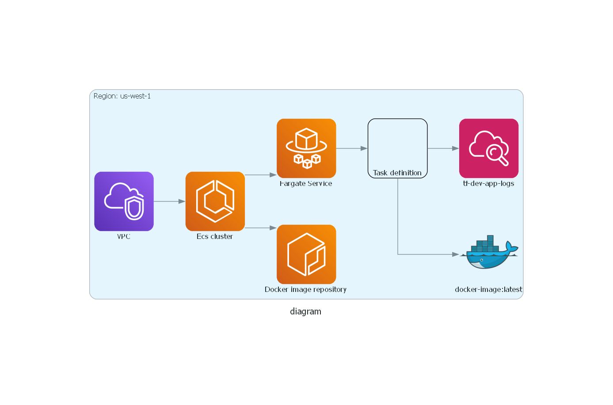

# ☁️ AWS Fargate with Terraform
Terraform project to deploy a containerized application on **Amazon ECS Fargate**. It provisions the core infrastructure: ECS cluster, task definition, Fargate service, security group, IAM execution role, and an ECR repository for Docker images.

Resources are organized into modules by AWS service to keep the configuration maintainable and easy to extend.

## 🏗️ Architecture
The stack creates:
| Resource | Description |
| --- | --- |
| ECS Cluster | Fargate cluster for running tasks |
| ECS Task Definition | Container spec (CPU, memory, image, ports) |
| ECS Service | Runs one Fargate task with public IP |
| Security Group | Allows inbound HTTP (port 80) |
| IAM Role | ECS task execution role |
| ECR Repository | Private registry for container images |

State is stored remotely in **S3** (`backend.tf`).

### 📊 Diagram


## 📋 Requirements
- [Terraform](https://developer.hashicorp.com/terraform/install) `>= 1.0`
- AWS Provider `>= 5.0.0`
- AWS account with permissions to manage ECS, ECR, IAM, EC2 (security groups), and S3
- An existing VPC and subnets

## 📁 Project structure
```
.
├── main.tf                 # Root module and provider
├── variables.tf            # Input variables
├── backend.tf              # S3 remote state
├── example.tfvars          # Example variable values
├── modules/
│   ├── ecs-cluster/        # Cluster, service, task definition, SG
│   ├── ecr/                # ECR repository
│   └── iam/                # ECS execution role
└── diagram/                # Architecture diagram
```

## ⚙️ Configuration
1. Copy the example variables file:

```bash
cp example.tfvars dev.tfvars
```

2. Edit `dev.tfvars` with your AWS values:
```hcl
region   = "sa-east-1"
vpc_id   = "vpc-xxxxxx"
subnets  = ["subnet-xxxxxx", "subnet-xxxxxx"]
cpu      = "1024"   # 1 vCPU
memory   = "2048"   # 2 GB
profile  = "your-aws-profile"
```

3. Provide AWS credentials via environment variables or CLI flags:
```bash
export TF_VAR_aws_access_key_id="YOUR_ACCESS_KEY"
export TF_VAR_aws_secret_access_key="YOUR_SECRET_KEY"
```

> `dev.tfvars` is listed in `.gitignore` to avoid committing sensitive or environment-specific values.

Resource names are built from the Terraform workspace and the `profile` variable (e.g. `tf-dev-test-ecs`).

## 🚀 Usage
Initialize Terraform and download providers:

```bash
terraform init
```

Create or select a workspace (used as the environment name):

```bash
terraform workspace select dev
# or
terraform workspace new dev
```

Review and apply changes:

```bash
terraform plan  -var-file=dev.tfvars
terraform apply -var-file=dev.tfvars
```

Destroy infrastructure:

```bash
terraform destroy -var-file=dev.tfvars
```

## 💡 Notes
- Update the container image in `modules/ecs-cluster/service-task-definition.tf` to point to your ECR repository before deploying.
- The Fargate service is configured with `assign_public_ip = true` and exposes port 80.
- Adjust `backend.tf` (S3 bucket, region, key) to match your remote state setup.

## 🏷️ Version
```
2.0.0
```